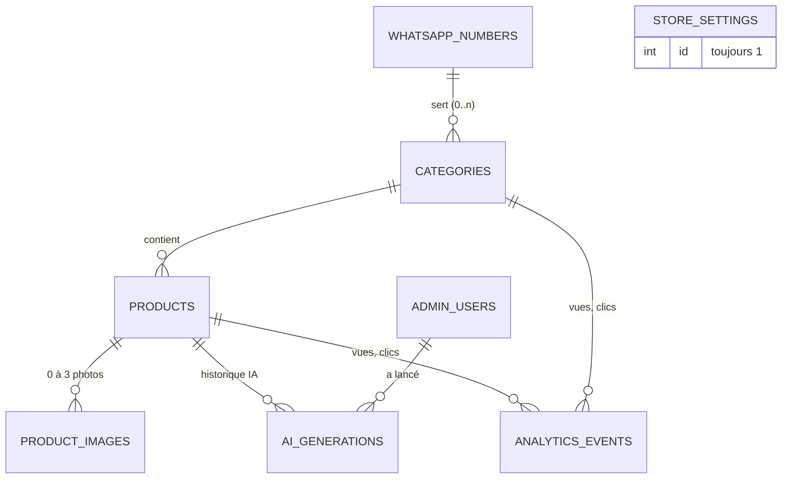

# Base de données

PostgreSQL 18, gérée avec **Prisma 7**. La source de vérité est `prisma/schema.prisma` ;
les règles que Prisma ne sait pas exprimer sont écrites en SQL dans les migrations.

## Schéma relationnel

## Tables

| Table | Rôle |
|---|---|
| `admin_users` | Comptes administrateur (mot de passe haché argon2id). Pas d'inscription publique. |
| `store_settings` | Paramètres du magasin, **une seule ligne** (`id = 1`). Champ vide = bloc masqué sur le site. |
| `whatsapp_numbers` | Numéros WhatsApp, format international sans « + » (`2126XXXXXXXX`). Un seul « par défaut ». |
| `categories` | Catégories (un seul niveau). Numéro WhatsApp facultatif. |
| `products` | Produits. **Aucun champ prix.** Statut `DRAFT` / `PUBLISHED` / `HIDDEN`. |
| `product_images` | Photos : positions 0 (principale), 1 et 2. Photo d'origine conservée si retouchée par l'IA. |
| `ai_generations` | Chaque appel IA : résultat, décision (accepté/refusé), tokens, coût estimé. |
| `analytics_events` | Vues et clics WhatsApp. Visiteur = hachage anonyme quotidien, sans cookie. |

## Règles métier garanties par la base

Ces règles sont vérifiées par PostgreSQL lui-même : même un bug dans le code ne peut pas les violer.

| Règle | Mécanisme |
|---|---|
| Un seul numéro WhatsApp par défaut | Index unique partiel `whatsapp_numbers_single_default_key` |
| Numéro au format E.164 | `CHECK phone ~ '^[1-9][0-9]{7,14}$'` |
| 3 photos maximum par produit | `CHECK position BETWEEN 0 AND 2` + unicité `(product_id, position)` |
| Impossible de supprimer une catégorie non vide | Clé étrangère `ON DELETE RESTRICT` |
| Supprimer un numéro ne supprime pas ses catégories | `ON DELETE SET NULL` → la catégorie retombe sur le numéro par défaut |
| Supprimer un produit supprime ses photos | `ON DELETE CASCADE` |
| Supprimer un produit conserve les statistiques globales | `ON DELETE SET NULL` sur `analytics_events` |
| Une seule ligne de paramètres | `CHECK id = 1` |
| Couleur principale valide | `CHECK primary_color ~ '^#[0-9A-Fa-f]{6}$'` |

## Résolution du numéro WhatsApp

Au clic sur le bouton d'un produit :
1. numéro de la catégorie du produit, s'il existe et est actif ;
2. sinon, le numéro marqué « par défaut ».

## Recherche

Deux index complémentaires sur `products` :

| Index | Usage | Opérateur |
|---|---|---|
| `products_search_fts_idx` (GIN, plein texte) | Recherche par mots, racinisation française, sans accents. Pondération : nom (A) > marque + référence (B) > description (C). | `public.product_search_document(name, brand, reference, description) @@ websearch_to_tsquery('french', public.immutable_unaccent($1))` |
| `products_name_trgm_idx` (GIN, trigrammes) | Tolérance aux fautes de frappe sur un mot du nom (« detergant » → « Détergent »). | `$1 <% public.immutable_unaccent(lower(name))` |

⚠️ Les requêtes doivent utiliser **exactement** ces expressions (fonctions qualifiées par `public.`),
sinon PostgreSQL n'utilise pas les index.

`immutable_unaccent` existe parce que `unaccent()` n'est pas déclarée IMMUTABLE, condition
obligatoire pour l'utiliser dans un index.

## Commandes

| Commande | Effet |
|---|---|
| `npm run db:up` / `db:down` | Démarrer / arrêter PostgreSQL (Docker). Les données sont conservées. |
| `npm run db:migrate` | Créer et appliquer une migration après modification du schéma, puis régénérer le client. |
| `npm run db:seed` | Données initiales (idempotent : relançable sans doublons). |
| `npm run db:studio` | Explorer la base dans le navigateur. |

## Modifier le schéma : points d'attention

- Prisma 7 ne régénère plus le client après `migrate dev` : le script `db:migrate` lance `generate` puis `migrate dev` (dans cet ordre, pour que `npm run db:migrate -- --name xxx` transmette bien le nom).
- Pour une règle SQL que Prisma ne gère pas : `npx prisma migrate dev --create-only --name <nom>`,
  compléter le fichier SQL, puis `npm run db:migrate`.
- Vérifier ensuite que Prisma ne voit pas de dérive (le résultat doit être une migration vide) :
  `npx prisma migrate diff --from-config-datasource --to-schema prisma/schema.prisma --script`
- Depuis PostgreSQL 17, la création d'un index utilise un `search_path` restreint :
  toujours qualifier les fonctions personnalisées (`public.…`).

## Seed

`prisma/seed.ts` crée, seulement s'ils n'existent pas :
1. les paramètres du magasin (textes préfixés `[À REMPLACER]`) ;
2. le compte admin défini par `ADMIN_EMAIL` / `ADMIN_PASSWORD` (jamais de réinitialisation) ;
3. si `SEED_DEMO_DATA=true` : 1 numéro fictif, 4 catégories, 12 produits (dont des brouillons et
   des produits mis en avant). **Jamais en production.**
